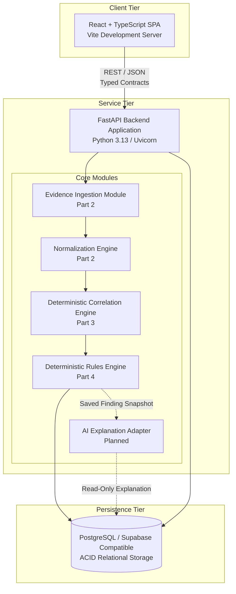
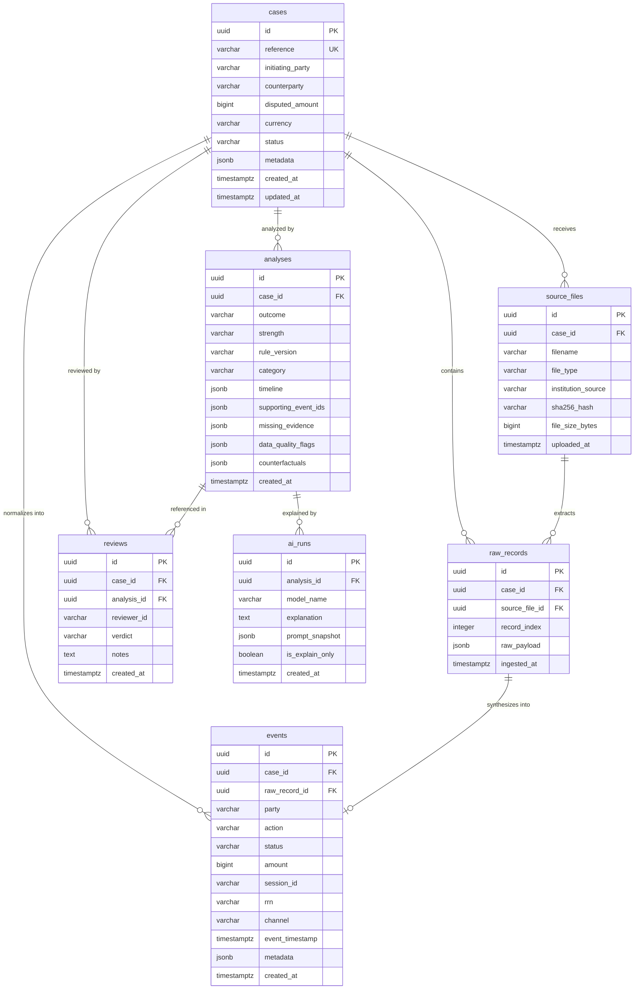
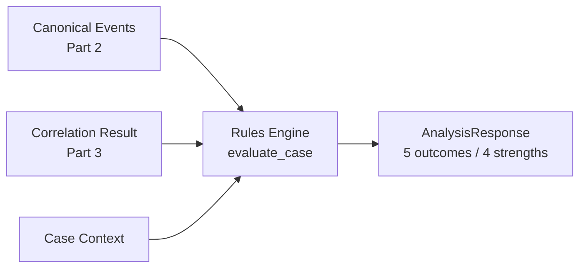

# TRACE Architecture Document

**System Version:** 1.0.0-draft (Part 1 Architectural Baseline)  
**Target Environment:** Local Development & Supabase/PostgreSQL Deployment  
**Status:** Frozen Initial Architecture & Data Contracts  

---

## 1. Executive Summary & Purpose

**TRACE** is a specialized transaction investigation platform built to resolve disputed or uncertain payment outcomes across multi-institution payment flows. In modern African payment rails (e.g., NIBSS Instant Payments, card switch transactions, merchant aggregators), failed, delayed, or disputed transfers frequently stem from inter-party communication gaps, timeout discrepancies, ledger misalignment, or partial settlements.

TRACE reconstructs end-to-end evidence chains from synthetic bank, switch/gateway, receiving-bank, and merchant records. 

### Core Architectural Axioms
1. **Deterministic Authority**: A deterministic rules engine owns **100%** of all analysis findings, classifications, outcomes, and strengths. 
2. **AI as Explainer Only**: Any downstream AI component functions strictly as a natural-language explainer of saved, deterministic findings. AI is never permitted to calculate, alter, classify, or override findings, confidence labels, or rule versions.
3. **Read-Only / No Financial Operations**: TRACE is an investigative observation and analysis system. TRACE **must never** initiate, approve, or execute fund transfers, refunds, reversals, credits, settlements, or any ledger movement.
4. **Synthetic Data Sandbox**: All data utilized in hackathon demos and local runs is strictly synthetic. There are no live banking integrations or live credentials.

---

## 2. High-Level System Architecture

TRACE is intentionally architected as a lean, monolithic service backed by a single relational database to maintain strict auditability, low operational overhead, and predictable execution.

### Component Boundaries
- **Frontend (`/frontend`)**: Single-Page Application (SPA) built with React and TypeScript. Responsible for displaying cases, uploading synthetic evidence, rendering interactive timelines, and presenting audit reports. Does not retain business logic or execute analysis locally.
- **Backend (`/backend/app`)**: Single FastAPI service handling ingestion, normalisation, deterministic rules execution, audit logging, and RESTful API endpoints.
- **Database**: Single PostgreSQL database (compatible with Supabase). Stores cases, raw records, normalized canonical events, frozen engine analyses, AI explanation logs, and human reviews.

### Conscious Non-Goals & Excluded Architecture
To maintain maximum reliability and eliminate hackathon anti-patterns, the following components are **strictly excluded**:
- **No Microservices**: Single backend service eliminates distributed transaction failures and service mesh complexity.
- **No Message Brokers (Kafka / RabbitMQ)**: Ingestion and deterministic analysis are synchronous or bounded background tasks handled in-process.
- **No WebSockets**: Standard REST request-response cycles provide predictable polling or state queries.
- **No Machine Learning Anomaly Detection**: Anomaly detection models produce non-reproducible probabilistic results that contradict the deterministic audit requirement.
- **No ISO 8583 Binary Parsing**: Ingestion targets tabular CSV and JSON representations of synthetic switch and core banking logs.

---

## 3. Non-Negotiable Data and Engineering Rules

The following ten rules govern all design decisions, schema constraints, and code implementations across TRACE:

| # | Rule | Architectural Implementation & Enforcement |
|---|------|-------------------------------------------|
| **1** | **Monetary values use integer minor units** | All monetary amounts are stored and calculated as 64-bit integers in minor units (e.g., Nigerian Naira uses kobo: `₦85,000` is represented as `8500000` kobo). Floating-point arithmetic is forbidden in persistence and engine calculation. |
| **2** | **Timestamps are ISO 8601 with timezone offsets; tolerance must not manufacture order** | All timestamps must include explicit timezone offsets (e.g., `2026-10-14T23:15:30.500+01:00`). Source timestamps are immutable and must never be rewritten. The ±5-second tolerance serves only to interpret potential inter-system clock skew, not as permission to force an artificial sequence or override contradictory evidence. If records do not establish an unambiguous sequence, observed timestamps are preserved verbatim and an ambiguous ordering flag (`CLOCK_SKEW_AMBIGUOUS_ORDERING`) is raised. |
| **3** | **Never merge transactions using amount and time alone; strict correlation hierarchy** | `(reference, amount)` alone must NEVER establish that records represent the same transaction, as references may not be globally unique and distinct payments share amounts. Correlation strictly requires (a) verified globally unique interbank identifiers (e.g., `(session_id, rrn)`), or (b) a verified institution-scoped reference `(institution_id, reference)` where uniqueness is established. Any other partial match must be treated strictly as an unconfirmed candidate match requiring additional evidence. |
| **4** | **Preserve raw source records separately from normalized events** | Raw source payloads (CSV rows, raw JSON payloads) are persisted in `raw_records` unchanged as immutable text/jsonb. Normalized canonical events in `events` maintain foreign key linkages back to the exact `raw_record_id` from which they were synthesized. |
| **5** | **A missing record is not proof that an event never happened** | The absence of a receiving bank credit log or switch response log must be categorized as `INSUFFICIENT_EVIDENCE` or flagged as a gap, rather than presuming the transfer affirmatively failed or did not occur. |
| **6** | **Critical data-quality issues cap finding strength at MODERATE** | When data quality flags indicate clock drift exceeding ±5s, missing mandatory reference fields, or contradictory party logs, the deterministic engine must not award a `HIGH` strength rating regardless of match outcome; maximum strength is capped at `MODERATE`. |
| **7** | **Identical normalized input with same rule version must produce identical findings** | The deterministic rules engine is a pure, idempotent function: `Evaluate(NormalizedEvents, RuleVersion) -> AnalysisFinding`. No non-deterministic elements (random numbers, system time during evaluation, unseeded sorts) are permitted. |
| **8** | **AI only explains engine results; never invents facts** | Any LLM/AI integration consumes only frozen `analyses` records. The AI must never invent events, entity IDs, amounts, timestamps, or statuses. The AI cannot authoritatively set `outcome`, `strength`, or `rule_version`. |
| **9** | **Use synthetic demo data only** | All institution profiles, account numbers, Bank Verification Numbers (BVN), card tokens, and customer names must be synthetic. No real-world PII or live banking credentials may be stored or referenced. |
| **10** | **No component may move money or trigger financial operations** | TRACE is an analytical and audit platform. It possesses no integration with payment gateways for disbursement, reversal, refund, transfer, or settlement. |

---

## 4. API Routes

The following RESTful API routes are defined under the prefix `/api/v1/`:

| Method | Endpoint | Purpose | Implemented in Part 1 |
|--------|----------|---------|-----------------------|
| `GET` | `/health` | Service liveness and dependency status probe | **Yes** (Operational) |
| `GET` | `/api/v1/health` | API v1 status and version probe | **Yes** (Operational) |
| `POST` | `/api/v1/cases` | Register a new disputed transaction case | Contract Defined |
| `GET` | `/api/v1/cases` | List and filter existing cases | Contract Defined |
| `GET` | `/api/v1/cases/{id}` | Retrieve case details, events, and latest analysis | Contract Defined |
| `POST` | `/api/v1/cases/{id}/evidence` | Ingest synthetic logs/records for a case | Contract Defined |
| `GET` | `/api/v1/cases/{id}/correlation` | Deterministic event correlation & ambiguity detection | **Yes** (Part 3) |
| `POST` | `/api/v1/cases/{id}/analyze` | Trigger deterministic rules engine evaluation | **Yes** (Part 4) |
| `GET` | `/api/v1/cases/{id}/evidence-pack` | Regenerate read-only structured evidence pack | **Yes** (Part 6) |
| `POST` | `/api/v1/cases/{id}/review` | Record human investigator verdict and notes | `501` — pending immutable analysis snapshots |

---

## 5. Initial Data Model Proposal

The relational persistence schema consists of 7 core entities designed for PostgreSQL / Supabase:

### Entity Specifications

#### 1. `cases`
- **Purpose**: Represents a distinct disputed payment incident requiring investigation.
- **Key Fields**: `id` (UUID, PK), `reference` (Unique dispute ref, e.g. `TRC-2026-001`), `initiating_party` (e.g. `ACCESS_BANK`), `counterparty` (e.g. `GTBANK`), `disputed_amount` (INT8, minor units), `currency` (CHAR(3), e.g. `NGN`), `status` (`OPEN`, `ANALYZED`, `REVIEWED`, `CLOSED`), `metadata` (JSONB).
- **Integrity**: Unique index on `reference`. Non-null positive `disputed_amount`.

#### 2. `source_files`
- **Purpose**: Tracks original uploaded synthetic log files (CSV/JSON) provided by participating institutions.
- **Key Fields**: `id` (UUID, PK), `case_id` (UUID, FK -> `cases.id`), `filename` (VARCHAR), `file_type` (`CSV`, `JSON`), `institution_source` (`ORIGINATING_BANK`, `SWITCH`, `RECEIVING_BANK`, `MERCHANT`), `sha256_hash` (VARCHAR(64)), `file_size_bytes` (INT8), `uploaded_at` (TIMESTAMPTZ).
- **Integrity**: `sha256_hash` guarantees tamper evidence and deduplication.

#### 3. `raw_records`
- **Purpose**: Immutable repository of raw, unparsed line items or payload objects from source files.
- **Key Fields**: `id` (UUID, PK), `case_id` (UUID, FK -> `cases.id`), `source_file_id` (UUID, FK -> `source_files.id`), `record_index` (INT4, 0-indexed row number), `raw_payload` (JSONB), `ingested_at` (TIMESTAMPTZ).
- **Integrity**: Strictly write-once/immutable. Compound unique index on `(source_file_id, record_index)`.

#### 4. `events`
- **Purpose**: Normalized, canonical financial events extracted from raw records.
- **Key Fields**: `id` (UUID, PK), `case_id` (UUID, FK -> `cases.id`), `raw_record_id` (UUID, FK -> `raw_records.id`), `party` (`ORIGINATING_BANK`, `SWITCH`, `RECEIVING_BANK`, `MERCHANT`), `action` (`DEBIT`, `CREDIT`, `SWITCH_IN`, `SWITCH_OUT`, `ACK`, `REVERSAL_ATTEMPT`), `status` (`SUCCESS`, `PENDING`, `FAILED`, `TIMEOUT`), `amount` (INT8 minor units), `session_id` (VARCHAR), `rrn` (VARCHAR), `channel` (VARCHAR, e.g. `USSD`, `MOBILE`, `WEB`), `event_timestamp` (TIMESTAMPTZ), `metadata` (JSONB).
- **Integrity**: FK to `raw_records.id` preserves end-to-end evidence lineage. Index on `(case_id, session_id)` and `(case_id, rrn)`.

#### 5. `analyses`
- **Purpose**: Frozen output of the deterministic rules engine evaluation.
- **Key Fields**: `id` (UUID, PK), `case_id` (UUID, FK -> `cases.id`), `outcome` (VARCHAR, 5 exact enums), `strength` (VARCHAR, 4 exact labels), `rule_version` (VARCHAR, e.g. `2026.1`), `category` (VARCHAR), `timeline` (JSONB, array of timeline objects), `supporting_event_ids` (JSONB, array of UUIDs), `missing_evidence` (JSONB, array of missing evidence descriptors), `data_quality_flags` (JSONB, array of flag objects), `counterfactuals` (JSONB, array of counterfactual scenarios), `created_at` (TIMESTAMPTZ).
- **Integrity**: Immutable. Check constraint on `outcome` restricted to the 5 permitted enum values; check constraint on `strength` restricted to the 4 permitted values.

#### 6. `ai_runs`
- **Purpose**: Audit record of natural language explanations synthesized from an existing analysis record.
- **Key Fields**: `id` (UUID, PK), `analysis_id` (UUID, FK -> `analyses.id`), `model_name` (VARCHAR), `explanation` (TEXT), `prompt_snapshot` (JSONB), `is_explain_only` (BOOLEAN, default TRUE), `created_at` (TIMESTAMPTZ).
- **Integrity**: Cannot link to `cases` directly without an authoritative `analysis_id`.

#### 7. `reviews`
- **Purpose**: Formal sign-off and final case determination by a human fraud/dispute analyst.
- **Key Fields**: `id` (UUID, PK), `case_id` (UUID, FK -> `cases.id`), `analysis_id` (UUID, FK -> `analyses.id`), `reviewer_id` (VARCHAR), `verdict` (VARCHAR, e.g. `CONCUR`, `OVERRULE`, `REQUEST_FURTHER_EVIDENCE`), `notes` (TEXT), `created_at` (TIMESTAMPTZ).
- **Integrity**: FK constraints to `case_id` and `analysis_id`.

---

## 6. Security, Configuration & Deployment Blueprint

1. **Secret Isolation**:
   - Backend secrets (`DATABASE_URL`, `SUPABASE_SERVICE_ROLE_KEY`, `GROQ_API_KEY`) reside exclusively in backend environment variables and `.env` (ignored by Git).
   - Frontend accesses only the backend public base URL (`VITE_API_BASE_URL`). Zero database credentials or AI API keys are exposed to the client.
2. **Local Development Workflow**:
   - Backend: Standard Python FastAPI runtime (`uvicorn app.main:app --reload --port 8000`).
   - Frontend: Vite dev server with TypeScript (`npm run dev -- --port 5173`).
3. **Target Deployment Compatibility**:
   - PostgreSQL engine standard SQL compatible with Supabase SQL Editor / migrations.
   - Fully containerizable single-container FastAPI backend and static-hostable React build (`/frontend/dist`).

---

## 7. Evidence Ingestion & Normalization Specifications (Part 2)

### 7.1 Supported Synthetic Evidence Formats
TRACE ingests synthetic evidence via **CSV** (Comma-Separated Values with header rows) and **JSONL** (Newline-Delimited JSON objects).

| Category | Institution Source | Supported Formats | Required Fields | Optional Fields |
|---|---|---|---|---|
| **Originating Bank Ledger** | `ORIGINATING_BANK` | CSV, JSONL | `timestamp`, `reference`, `amount`, `currency`, `status` | `action` (default `DEBIT`), `session_id`, `rrn`, `channel`, `account_number`, `narration` |
| **Switch/Gateway Journal** | `SWITCH` | CSV, JSONL | `timestamp`, `session_id`, `action`, `status`, `amount`, `currency` | `rrn`, `reference`, `source_institution`, `destination_institution`, `response_code` |
| **Receiving Bank Ledger** | `RECEIVING_BANK` | CSV, JSONL | `timestamp`, `reference`, `amount`, `currency`, `status` | `action` (default `CREDIT`), `session_id`, `rrn`, `beneficiary_account`, `narration` |
| **Merchant Order Records** | `MERCHANT` | CSV, JSONL | `timestamp`, `order_id`, `reference`, `amount`, `currency`, `status` | `action` (default `ACK`), `session_id`, `rrn`, `customer_id` |

### 7.2 Strict Ingestion & Validation Rules
1. **Integer Minor Units**: Amounts must be positive integers representing minor currency units (e.g., `8500000` kobo for ₦85,000). Floating-point amounts (e.g. `85000.50`) and negative/zero values are strictly rejected.
2. **Explicit Timezone Offsets**: Timestamps must follow ISO 8601 with an explicit timezone offset (e.g., `2026-10-14T22:15:30.120+01:00` or `Z`). Timezone-naive timestamps are rejected without guessing or silently inferring UTC.
3. **Whitelisted Currencies**: Currency codes must belong to the approved set (`NGN`, `USD`, `EUR`, `GBP`).
4. **Configurable Guardrails**:
   - `MAX_UPLOAD_SIZE_BYTES`: 5 MB (5,242,880 bytes). Uploads exceeding this return HTTP 413.
   - `MAX_UPLOAD_ROWS`: 2,000 records per upload batch.
5. **Deduplication**: Ingestion calculates the SHA-256 hash of raw file bytes. If an identical file hash has already been ingested for the target case, the upload is rejected with HTTP 409 Conflict.
6. **Transactional Atomicity**: Source file metadata, raw records, and canonical events are committed within a single database transaction. Any parsing or validation failure triggers a full rollback, leaving zero partial or corrupt state.
7. **Lineage Preservation**: Every normalized event stores a mandatory foreign key link to its originating `raw_record_id`. Raw payloads are preserved verbatim in `raw_records.raw_payload`.

### 7.3 Database Migrations & Multi-Engine Compatibility
- **PostgreSQL / Supabase**: Standard DDL migrations reside in `/backend/migrations/001_initial_schema.sql` and can be executed directly in the Supabase SQL Editor or via `psql`.
- **Local Unit Testing**: Test suites execute against an in-memory SQLite database utilizing SQLAlchemy's `StaticPool` and a platform-independent `TZDateTime` TypeDecorator, preserving timezone offsets without requiring a live Supabase account or Docker daemon.

### 7.4 Correlation & Timestamp Ordering Governance (Part 3)
1. **Identifier Scope & Anti-Merging**:
   - Transaction identifiers are **not** universally unique. **Global** identifiers (`session_id`, `rrn`) are treated as interbank identifiers with global scope only when consistent across events; contradictions surface as `AMBIGUOUS`. **Institution-local** identifiers (`reference`, especially institution-scoped) are never assumed globally unique.
   - Amount and timestamp proximity alone must **never** confirm a transaction match. They may only identify **candidate** groups requiring human review.
   - Contradictory identifiers (e.g., matching session_id with differing RRNs; same RRN with differing session_ids; conflicting currencies under linked identifiers) are **never silently resolved**—transitive conflicts across connected evidence clusters are surfaced as ambiguous.

2. **Deterministic Match Hierarchy**:
   1. **Strong (CONFIRMED)**: Events connected by globally unique identifiers (`session_id` and/or `rrn`) with all non-null identifier values mutually consistent and currency consistent. Singleton-identifier strong links are permitted when verified and consistent.
   2. **Secondary (CONFIRMED or CANDIDATE)**: Institution-scoped `reference` links may be confirmed only for a verified cross-source (cross-party) shared reference with a single currency and amount; same-institution repeated references are candidate-only.
   3. **Candidate (CANDIDATE)**: Equal amount + equal currency + timestamps within ±5s tolerance, lacking verified unique identifiers.
   4. **Unmatched (UNMATCHED)**: Insufficient corroborating identifiers or unresolved conflict.

3. **Time Tolerance & Ordering**:
   - Observed source timestamps are immutable evidence and are **never rewritten**.
   - The **±5-second clock-skew tolerance** is applied **exclusively** for assessing candidate proximity and for detecting potential clock skew. It does not override contradictory identifiers or fabricate ordering.
   - If event ordering is ambiguous within ±5s (e.g., downstream leg stamped earlier than upstream; sub-0.1s separation), `temporal_ordering_ambiguous` is set to `true` on the group; raw timestamps are preserved verbatim.
   - Currency-aware comparisons are used; same numeric amount in different currencies is never confirmed.

4. **Algorithm Versioning & Determinism**:
   - Correlation is pure and versioned (e.g., `2026.1.0-corr`). Given identical normalized events and the same algorithm version, outputs are identical. Input/output ordering is deterministic (sorted timestamps, party, event_id). All set-derived lists are emitted in sorted order to eliminate hash-randomization variance.
   - Correlation results are computed **on-the-fly** from persisted canonical events and raw records (no persistent correlation-group tables are required for this design). Repeated runs do not mutate source events or create duplicate persisted artifacts.
   - **Scope**: Correlation is scoped to a single case by default; cross-case correlation is rejected.

5. **Auditability & Limitations**:
   - Every correlation group preserves member `event_id`s, `raw_record_id`s, institution party, timestamps, identifiers, and identifying keys that justified the link. Contradictions and duplicate-identity event IDs are explicitly surfaced.
   - **Correlation does not decide transaction outcomes.** It identifies linkage, candidate matches, ambiguity, or unmatched events only. It never infers success/failure/reversal/discrepancy or changes the frozen enums.
   - Known limitations: very sparse identifiers can yield many `UNMATCHED`; deliberate identifier reuse (institution-local) is treated conservatively as candidate; transient clock skew may create ambiguity without inferring sequence.

---

## 8. Deterministic Rules Engine (Part 4)

### 8.1 Purpose & Position

The rules engine (`backend/app/rules/engine.py`, `evaluate_case`) is the **sole authority** that assigns the five exact outcome enums and four qualitative strength labels. It consumes Part 2 canonical events and Part 3 correlation results and returns a fully justified `AnalysisResponse`.

### 8.2 Determinism & Purity

- **Version**: `2026.1.0-rules`, stamped on every response.
- **Pure function**: no mutation of events/raw records, no persistence, no use of wall-clock time during evaluation. All set-derived collections are sorted so hash randomization cannot affect output.
- **Compute-on-demand**: `POST /api/v1/cases/{id}/analyze` recomputes from persisted canonical events. No `analyses` row is written (the `analyses` table remains reserved for a future frozen-snapshot feature); repeated calls are therefore idempotent by construction.

### 8.3 Precedence & Capping

The engine applies the ordered rule hierarchy documented in `docs/api-contract.md` §5.2 (same-leg contradiction → linked amount mismatch → multiple unreversed debits → downstream timeout → downstream failure → reversal-vs-downstream-value → system reversal → unverified merchant refund → clean settlement → downstream-success-without-settlement → unlinked similar evidence → fallback).

**Payment-leg model.** Each core action belongs to exactly one payment leg: `DEBIT` → ORIGINATION, `SWITCH_OUT` → OUTBOUND_TRANSIT, `SWITCH_IN`/`CREDIT` → INBOUND_SETTLEMENT. This distinction is load-bearing: opposing terminal statuses on the **same** leg are contradictory (rule A), whereas a `SUCCESS` on one leg and a `FAILED` status on a **different** leg describe a consistent cross-stage failure (rules D/D2). A receiving-bank `CREDIT FAILED` is therefore affirmative failure evidence for the downstream leg, never a contradiction of an upstream `DEBIT SUCCESS`.

Linkage-dependent rules (A, B, F) are gated on Part 3 `CONFIRMED` groups; candidate/ambiguous proximity can never confirm a discrepancy or a clean settlement. Rule C additionally refuses to count successful debits that fall inside a CANDIDATE/AMBIGUOUS group as independent double debits. `CRITICAL`/`MEDIUM` data-quality flags cap strength at `MODERATE`; `LOW` flags never cap. Exact duplicate evidence signatures are collapsed to a single canonical leg and surfaced via a `DUPLICATE_EVIDENCE` (LOW) flag, never double-counted. Genuinely incompatible evidence (same-leg opposing terminal statuses, or a successful reversal/credit alongside a downstream payment) is surfaced in `contradicting_evidence` rather than discarded, and `supporting_evidence`/`contradicting_evidence` are always disjoint.

### 8.4 Traceability

Every finding enumerates `supporting_evidence`, `contradicting_evidence`, `alternative_explanations`, `data_quality_flags`, `missing_evidence`, and `recommended_next_evidence`. Missing legs degrade to `INSUFFICIENT_EVIDENCE` rather than being assumed, upholding Rule 5 ("a missing record is not proof that an event never happened"). Every `INSUFFICIENT_EVIDENCE` finding emits at least one actionable `recommended_next_evidence` entry. Rules E2, G and I emit `INSUFFICIENT` strength; rule H is the single documented exception (`INSUFFICIENT_EVIDENCE` / `LOW`), reflecting a weak directional possible-linkage pattern, per the §1.2 governance rule.
